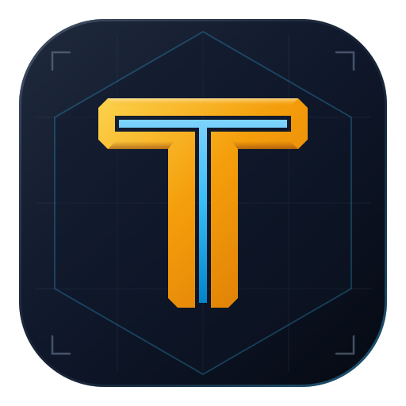

<div align="center">



# Tecton - Local-First Construction Site Operating System for Windows

</div>

---

<div align="center">

[](#english-version)
&nbsp;&nbsp;&nbsp;&nbsp;
[](#turkish-version)

</div>

---

<div align="center">

[](https://github.com/emirtdede/tecton/actions/workflows/ci.yml)


</div>

---

<a id="english-version"></a>
# English Version

<div align="center">
  <h3>Tecton - Site, Payroll, Material and Cash Control in One Offline Desktop App</h3>
  <p><em>Workers, timesheets, production, materials, subcontractors, cash register, reports, 15 themes, 73 installer languages and serverless cloud backup</em></p>
  <p><strong>Developed &amp; Published by Emir Tarik Dede</strong></p>
</div>

<br>

## Project Overview

**Tecton (`v1.0.0`)** is a local-first Windows desktop application that runs a construction site end to end. Built with **Electron 29**, **React 18**, **Vite 5** and a local **SQLite** database, everything works without an account, a cloud service or an internet connection.

One database holds the whole site: projects, work types, worker groups, workers, leaves, timesheets, advances, transactions, cash register entries, daily journals, materials, deliveries, production records, quality reports, subcontractor contracts and media files. Every screen is connected, so a timesheet updates payroll, a delivery updates stock, and a subcontractor payment updates the ledger and the cash balance in the same pass.

Tecton is built for people who work on site, not in a data centre. It starts with Windows silently in the system tray, opens from anywhere with **Ctrl + Alt + N**, follows the Windows light/dark setting, and can be operated with a single hand from a laptop keyboard.

> **Documentation:** architecture, release process, QA reports and screenshots are indexed in [`docs/README.md`](docs/README.md).

---

## Key Features

### Site and Project Control
- Projects with status, start date, location and budget, plus a per-project dashboard.
- Work types, worker groups and worker records with Turkish ID validation, phone, wage and tags.
- Worker profile pages that combine attendance, advances, leaves and payments in one timeline.
- Bulk timesheet entry for a whole crew in one screen, with per-day presence and overtime.

### Payroll and Financial Control
- Wage engine with daily, weekly and monthly models, overtime multipliers and advance deductions.
- Subcontractor contracts, progress payments, retention and running balance.
- Cash register with income/expense entries, categories and a live balance.
- Transactions ledger with colour-coded direction and project attribution.
- Profitability and cost reports per project, per worker group and per period, exportable to PDF and Excel.

### Production, Materials and Quality
- Material catalogue with units, minimum stock and supplier information.
- Deliveries that increase stock atomically; consumption follows production records.
- Production records with quantity, unit, location and crew attribution.
- Quality reports and non-conformance tracking per project and per production batch.
- Media gallery for site photos, linked to a project, worker or record.

### Daily Operations
- Daily journal with weather, crew on site, machinery, deliveries and free-form notes.
- Anomaly panel that flags missing timesheets, negative stock, duplicate payments and overdue balances.
- Global search (Ctrl + K) across every module.
- Recycle bin for soft-deleted records with a one-click restore.

### Serverless Cloud Backup
- Writes a single JSON snapshot into the folder your provider already syncs.
- Auto-detects OneDrive (`OneDriveConsumer`, `OneDrive`, `OneDriveCommercial`, `~/OneDrive`), Google Drive, Dropbox, iCloud Drive and Nextcloud.
- Custom folder selection with "open in Explorer" and a safe local fallback when no provider exists.
- Layout: `tecton-sync.json`, `tecton-sync-previous.json` and `tecton-backup-YYYY-MM-DD.json`, rotating 15 days.
- Atomic writes (`.tmp-<pid>` + rename, `copyFile` fallback on `EBUSY`/`EPERM`).
- Recovery chain: current file, then previous, then the newest valid daily backup.
- Never overwrites a valid remote backup with an empty local database; after a format it offers "Restore from OneDrive" or "Start fresh".
- Debounced background sync (300 ms) plus a flush on close, so a closed laptop still leaves a complete snapshot.

### Windows Platform Integration
- Start with Windows into the system tray, without a window flash.
- Global hotkey **Ctrl + Alt + N** to summon the window from any application.
- System theme following (system, light, dark) that recolours the window, the tray icon and the installer icon set.
- Windows Jump List with two tasks: "New timesheet" and "Open cash register".
- Per-user NSIS installer with a language picker on the very first page.
- Advanced updater on **electron-updater** and GitHub Releases: delta download through `.blockmap`, SHA-512 verification, silent install and restart, guarded by `process.windowsStore`.

### Appearance and Accessibility
- 15 palettes: 14 curated sets plus a custom hex colour with automatic contrast-corrected foreground.
- Selectable application icon that recolours the desktop shortcut, taskbar, tray and window.
- UI zoom from 80% to 150%, high contrast, reduced motion, larger text and underline links.
- Right-to-left layout support for Arabic and Hebrew.
- Two-level sidebar: an icon rail for modules and a contextual panel for pages.

### Internationalisation
- 73 installer languages on the first setup page, preselected from the Windows display language with English fallback.
- 19 complete interface dictionaries: Turkish, English, German, Spanish, French, Italian, Portuguese, Dutch, Polish, Russian, Japanese, Korean, Chinese, Swedish, Norwegian, Danish, Czech, Arabic and Hindi.
- Every new string ships in all 19 dictionaries; the i18n gate fails on any missing key or placeholder mismatch.
- No hardcoded language, no Turkish leak in another locale, no emoji placeholders.

---

## Tech Stack

### Runtime and UI
- **Electron 29** with a hardened main process and a sandboxed, context-isolated renderer.
- **React 18** with hooks, lazy-loaded views and i18next for translations.
- **Vite 5** for the renderer build and HMR in development.
- **lucide-react** icon set (no emoji anywhere in the interface).
- Hand-written CSS design system driven by CSS custom properties and per-theme tokens.

### Data and Security
- **SQLite** (WAL mode) accessed only from the main process through a typed service layer.
- Context isolation on, node integration off, `window.api` as the only bridge.
- Navigation allow-list, denied `window.open`, denied webviews and denied permission requests.
- Per-user data path: `%APPDATA%/Tecton/elektronik-yevmiye.sqlite`.
- Rotation-safe backups with `VACUUM INTO` and an integrity check on shutdown.

### Backup and Update
- **electron-updater 6** with GitHub Releases and `.blockmap` delta downloads.
- **electron-log 5** for rotating main-process logs.
- **jsPDF** and **SheetJS** for PDF and Excel exports.

### Build, Test and Release
- **Vitest 4** for unit and service tests.
- **electron-builder 24** with a dedicated `electron-builder.config.cjs`.
- Custom NSIS language page generated by `npm run installer:langs`.
- **rcedit** for executable metadata and icon, so builds work without Administrator rights.
- GitHub Actions CI: install, style gate, i18n gate, tests, renderer build and packaging on Windows.

---

## Project Structure

```
Tecton/
|-- build/                    NSIS custom pages and the language catalogue generator output
|-- docs/                     Reports, screenshots and documentation index
|-- scripts/                  Brand assets, installer languages, quality gates, afterPack
|-- src/
|   |-- main/                 Electron main process
|   |   |-- database/         SQLite schema, seeds and migrations
|   |   |-- services/         Balance, financial, report, wage, cloud, platform, updater
|   |   |-- utils/            Error mapping, media paths, ICO writer
|   |   |-- index.js          Window lifecycle, single instance, tray, shutdown
|   |   `-- ipcHandlers.js    Every IPC channel in one auditable place
|   |-- preload/              contextBridge API surface
|   `-- renderer/             React application
|       |-- src/components/   Modules, settings panels, onboarding wizard
|       |-- src/config/       Languages, themes, navigation
|       |-- src/locales/      19 translation dictionaries
|       `-- src/utils/        Formatters, CSV, date ranges
|-- tecton_assets/            Brand SVGs, PNGs and multi-size ICOs
|-- electron-builder.config.cjs
|-- package.json
`-- vitest.config.js
```

---

## Architecture and Security Boundaries

- The renderer never touches SQLite, the file system or the registry directly. It calls `window.api.*`, which invokes a named IPC channel.
- Every IPC handler validates its payload and converts internal errors to a safe user payload through `toUserErrorPayload`, so no stack trace or SQL text reaches the interface.
- The main process owns the database connection, the cloud writer, the tray, the login item, the global shortcut, the Jump List and the updater.
- A single-instance lock prevents two writers from opening the same database; a second launch focuses the existing window.
- Navigation is restricted to the bundled `file://` and development `localhost` origins. External links open in the default browser through `shell.openExternal`.
- `process.windowsStore` disables the updater, so a Microsoft Store build never tries to replace itself.

---

## Storage and Data Safety

| Item | Location |
| --- | --- |
| Database (installed) | `%APPDATA%/Tecton/elektronik-yevmiye.sqlite` |
| Database (development) | `.tecton-dev-data/database.sqlite` |
| Logs (installed) | `%APPDATA%/Tecton/logs` |
| Logs (development) | `.tecton-dev-data/logs` |
| Backups | `%APPDATA%/Tecton/Database-Backups` |
| Cloud snapshot | `<provider folder>/Tecton/tecton-sync.json` |

- The database runs in WAL mode with a busy timeout, so a slow report never blocks data entry.
- Shutdown runs `VACUUM INTO` to write a compact backup, then an integrity check, then flushes the pending cloud snapshot.
- Every cloud write is atomic; a killed process leaves either the old file or the new one, never a half file.
- A damaged snapshot is skipped silently and the reader walks the recovery chain.

---

## Installation and Usage

### Installing as an end user (from the setup file)
1. Download `Tecton-Setup-1.0.0.exe` from the Releases page.
2. Run it. The first page asks for the installer and application language (73 choices, Windows language preselected).
3. Choose the installation folder (per-user install, no Administrator prompt required) and finish.
4. Tecton starts in the selected language and opens the four-step welcome: language, theme, welcome message and a short tour.

### Prerequisites (building from source)
- Windows 10 or 11 x64
- Node.js 20 or newer
- npm 10 or newer

### Run from Source

```bash
git clone https://github.com/emirtdede/tecton.git
cd tecton
npm install
npm run dev
```

`npm run dev` starts Vite on port 5173 and launches Electron once the dev server is ready. Development data is written to `.tecton-dev-data/`, so your real installation is never touched.

### Tests and Release Gates

```bash
npm test            # Vitest unit and service tests
npm run quality     # style gate, i18n gate and tests
npm run style:check # no em dashes, no emoji
npm run i18n:check  # key parity across 19 dictionaries
```

### Build Installers

```bash
npm run build           # renderer build, installer languages, NSIS setup
npm run build:react     # renderer only
npm run build:electron  # language catalogue and NSIS setup
npm run installer:langs # regenerate build/installer-languages.nsh
npm run brand           # regenerate PNG and ICO brand assets
```

Output lands in `release/`:
- `Tecton-Setup-1.0.0.exe` (per-user NSIS installer, 73-language picker)
- `Tecton-Setup-1.0.0.exe.blockmap` (delta update map)
- `latest.yml` (electron-updater manifest)
- `win-unpacked/` (unpacked application for inspection)

---

## Distribution Packages

| Package | Contents | Notes |
| --- | --- | --- |
| NSIS setup | `Tecton-Setup-1.0.0.exe` | Per-user install, language picker first, desktop and Start Menu shortcuts |
| Delta update map | `Tecton-Setup-1.0.0.exe.blockmap` | Used by electron-updater to download only changed blocks |
| Update manifest | `latest.yml` | Version, SHA-512 and size consumed by the updater |
| Unpacked build | `win-unpacked/` | Portable inspection build, not for distribution |

---

## License and Publisher

- **License:** MIT. See [`LICENSE`](LICENSE).
- **Developer and publisher:** Emir Tarik Dede
- **Source code:** https://github.com/emirtdede/tecton
- **Support:** open an issue on the repository.

Tecton works offline and ships no telemetry, no analytics and no advertising. Your records stay in the local database and, only if you connect one, in the cloud folder you choose.

---

<br>

<a id="turkish-version"></a>
# Türkçe Versiyon

<div align="center">
  <h3>Tecton - Şantiye, Bordro, Malzeme ve Kasa Kontrolü Tek Bir Çevrimdışı Masaüstü Uygulamasında</h3>
  <p><em>Personel, puantaj, üretim, malzeme, taşeron, kasa, raporlar, 15 tema, 73 kurulum dili ve sunucusuz bulut yedekleme</em></p>
  <p><strong>Geliştiren ve Yayınlayan: Emir Tarık Dede</strong></p>
</div>

<br>

## Proje Genel Bakış

**Tecton (`v1.0.0`)**, bir inşaat şantiyesini uçtan uca yöneten yerel öncelikli bir Windows masaüstü uygulamasıdır. **Electron 29**, **React 18**, **Vite 5** ve yerel **SQLite** veritabanı ile geliştirilmiştir; hesap, bulut servisi veya internet bağlantısı olmadan çalışır.

Tek bir veritabanı tüm şantiyeyi taşır: projeler, iş türleri, personel grupları, personel, izinler, puantajlar, avanslar, işlemler, kasa hareketleri, günlük kayıtlar, malzemeler, teslimatlar, üretim kayıtları, kalite raporları, taşeron sözleşmeleri ve medya dosyaları. Tüm ekranlar birbirine bağlıdır; bir puantaj bordroyu, bir teslimat stoğu, bir taşeron ödemesi hem cariyi hem kasa bakiyesini aynı anda günceller.

Tecton, veri merkezinde değil sahada çalışan insanlar için tasarlandı. Windows ile birlikte sessizce sistem tepsisinde başlar, **Ctrl + Alt + N** ile her yerden açılır, Windows açık/koyu ayarını takip eder ve dizüstü klavyesiyle tek elle kullanılabilir.

> **Dokümantasyon:** mimari, sürüm süreci, QA raporları ve ekran görüntüleri [`docs/README.md`](docs/README.md) içinde listelenmiştir.

---

## Öne Çıkan Özellikler

### Şantiye ve Proje Kontrolü
- Durum, başlangıç tarihi, konum ve bütçe ile projeler ve proje bazlı gösterge paneli.
- İş türleri, personel grupları ve T.C. kimlik doğrulaması, telefon, ücret ve etiketlerle personel kayıtları.
- Devam, avans, izin ve ödemeleri tek zaman çizelgesinde birleştiren personel profil sayfaları.
- Tüm ekibi tek ekranda giren, gün bazlı devam ve fazla mesai destekli toplu puantaj.

### Bordro ve Mali Kontrol
- Günlük, haftalık ve aylık modeller, fazla mesai katsayıları ve avans kesintileri ile ücret motoru.
- Taşeron sözleşmeleri, hakediş ödemeleri, teminat kesintisi ve yürüyen bakiye.
- Gelir/gider kayıtları, kategoriler ve canlı bakiye ile kasa.
- Yönü renk kodlu ve proje atamalı işlem defteri.
- Proje, personel grubu ve dönem bazlı kârlılık ve maliyet raporları; PDF ve Excel çıktısı.

### Üretim, Malzeme ve Kalite
- Birim, minimum stok ve tedarikçi bilgisi ile malzeme kataloğu.
- Stoğu atomik olarak artıran teslimatlar; üretim kayıtlarıyla birlikte tüketim.
- Miktar, birim, konum ve ekip atamalı üretim kayıtları.
- Proje ve üretim partisi bazında kalite raporları ve uygunsuzluk takibi.
- Proje, personel veya kayda bağlı saha fotoğrafları için medya galerisi.

### Günlük Operasyon
- Hava durumu, sahadaki ekip, makine, teslimatlar ve serbest notlarla günlük kayıt.
- Eksik puantaj, negatif stok, mükerrer ödeme ve gecikmiş bakiyeleri işaretleyen anomali paneli.
- Tüm modüllerde genel arama (Ctrl + K).
- Silinen kayıtlar için geri dönüşüm kutusu ve tek tıkla geri yükleme.

### Sunucusuz Bulut Yedekleme
- Sağlayıcınızın zaten eşitlediği klasöre tek bir JSON anlık görüntüsü yazar.
- OneDrive (`OneDriveConsumer`, `OneDrive`, `OneDriveCommercial`, `~/OneDrive`), Google Drive, Dropbox, iCloud Drive ve Nextcloud otomatik algılanır.
- Özel klasör seçimi, Explorer'da açma ve sağlayıcı yoksa güvenli yerel klasöre düşme.
- Dosya düzeni: `tecton-sync.json`, `tecton-sync-previous.json` ve 15 gün dönen `tecton-backup-YYYY-MM-DD.json`.
- Atomik yazma (`.tmp-<pid>` + rename, `EBUSY`/`EPERM` durumunda `copyFile`).
- Kurtarma zinciri: güncel dosya, ardından önceki dosya, ardından en yeni geçerli günlük yedek.
- Geçerli bulut yedeğinin üzerine boş yerel veritabanı yazmaz; format sonrası "OneDrive'dan Geri Yükle" veya "Yeni Başlangıç Yap" sunar.
- 300 ms gecikmeli arka plan eşitleme ve kapanışta bekleyen yazmayı tamamlama.

### Windows Platform Entegrasyonu
- Windows ile birlikte pencere parlaması olmadan sistem tepsisinde başlama.
- Her uygulamadan pencereyi öne getiren **Ctrl + Alt + N** genel kısayolu.
- Pencereyi, tepsi simgesini ve kurulum simge setini yeniden renklendiren sistem teması takibi (sistem, açık, koyu).
- İki görevli Windows Jump List: "Yeni puantaj" ve "Kasayı aç".
- İlk sayfasında dil seçici bulunan kullanıcı bazlı NSIS kurulumu.
- **electron-updater** ve GitHub Releases üzerinde gelişmiş güncelleyici: `.blockmap` ile delta indirme, SHA-512 doğrulama, sessiz kurulum ve yeniden başlatma, `process.windowsStore` koruması.

### Görünüm ve Erişilebilirlik
- 15 palet: 14 hazır tema ve kontrast düzeltmeli özel hex rengi.
- Masaüstü kısayolunu, görev çubuğunu, tepsiyi ve pencereyi yeniden renklendiren seçilebilir uygulama simgesi.
- %80 ile %150 arası arayüz yakınlaştırması, yüksek kontrast, hareket azaltma, büyük metin ve altı çizili bağlantılar.
- Arapça ve İbranice için sağdan sola yerleşim desteği.
- İki seviyeli kenar çubuğu: modüller için simge rayı, sayfalar için bağlamsal panel.

### Çoklu Dil
- İlk kurulum sayfasında 73 kurulum dili; Windows görüntüleme dilinden ön seçim, eşleşme yoksa İngilizce.
- 19 tam arayüz sözlüğü: Türkçe, İngilizce, Almanca, İspanyolca, Fransızca, İtalyanca, Portekizce, Hollandaca, Lehçe, Rusça, Japonca, Korece, Çince, İsveççe, Norveççe, Danca, Çekçe, Arapça ve Hintçe.
- Her yeni metin 19 sözlüğün tamamında bulunur; i18n kapısı eksik anahtar veya yer tutucu uyuşmazlığında derlemeyi durdurur.
- Sabit kodlanmış dil yok, başka bir yerelde Türkçe sızıntısı yok, emoji yer tutucu yok.

---

## Teknoloji Yığını

### Çalışma Zamanı ve Arayüz
- **Electron 29**: sağlamlaştırılmış ana süreç, sandbox'lı ve context isolation açık arayüz.
- **React 18**: hook'lar, tembel yüklenen görünümler ve i18next çevirileri.
- **Vite 5**: arayüz derlemesi ve geliştirmede HMR.
- **lucide-react** simge seti (arayüzde hiç emoji yok).
- CSS özel değişkenleri ve tema belirteçleriyle yazılmış tasarım sistemi.

### Veri ve Güvenlik
- **SQLite** (WAL modu), yalnızca ana süreçten servis katmanı üzerinden erişilir.
- Context isolation açık, node integration kapalı, tek köprü `window.api`.
- Gezinme izin listesi, reddedilen `window.open`, reddedilen webview ve izin istekleri.
- Kullanıcı bazlı veri yolu: `%APPDATA%/Tecton/elektronik-yevmiye.sqlite`.
- Kapanışta `VACUUM INTO` ve bütünlük kontrolü ile rotasyonlu yedekler.

### Yedekleme ve Güncelleme
- **electron-updater 6**: GitHub Releases ve `.blockmap` delta indirme.
- **electron-log 5**: dönen ana süreç günlükleri.
- **jsPDF** ve **SheetJS**: PDF ve Excel çıktıları.

### Derleme, Test ve Sürüm
- **Vitest 4** ile birim ve servis testleri.
- Ayrı `electron-builder.config.cjs` ile **electron-builder 24**.
- `npm run installer:langs` ile üretilen özel NSIS dil sayfası.
- Yönetici hakkı gerektirmeyen derlemeler için **rcedit** ile exe meta verisi ve simgesi.
- GitHub Actions CI: kurulum, stil kapısı, i18n kapısı, testler, arayüz derlemesi ve Windows paketleme.

---

## Proje Yapısı

```
Tecton/
|-- build/                    NSIS özel sayfaları ve dil kataloğu çıktısı
|-- docs/                     Raporlar, ekran görüntüleri ve doküman dizini
|-- scripts/                  Marka varlıkları, kurulum dilleri, kalite kapıları, afterPack
|-- src/
|   |-- main/                 Electron ana süreci
|   |   |-- database/         SQLite şeması, tohumlar ve geçişler
|   |   |-- services/         Bakiye, mali, rapor, ücret, bulut, platform, güncelleyici
|   |   |-- utils/            Hata eşleme, medya yolları, ICO yazıcı
|   |   |-- index.js          Pencere yaşam döngüsü, tek örnek, tepsi, kapanış
|   |   `-- ipcHandlers.js    Tüm IPC kanalları tek denetlenebilir yerde
|   |-- preload/              contextBridge API yüzeyi
|   `-- renderer/             React uygulaması
|       |-- src/components/   Modüller, ayar panelleri, karşılama sihirbazı
|       |-- src/config/       Diller, temalar, gezinme
|       |-- src/locales/      19 çeviri sözlüğü
|       `-- src/utils/        Biçimlendiriciler, CSV, tarih aralıkları
|-- tecton_assets/            Marka SVG, PNG ve çok boyutlu ICO dosyaları
|-- electron-builder.config.cjs
|-- package.json
`-- vitest.config.js
```

---

## Mimari ve Güvenlik Sınırları

- Arayüz SQLite'a, dosya sistemine veya kayıt defterine doğrudan erişmez. `window.api.*` çağırır, o da adlandırılmış bir IPC kanalını tetikler.
- Her IPC işleyicisi yükünü doğrular ve iç hataları `toUserErrorPayload` ile güvenli kullanıcı yüküne çevirir; arayüze yığın izi veya SQL metni sızmaz.
- Veritabanı bağlantısı, bulut yazıcısı, tepsi, başlangıç öğesi, genel kısayol, Jump List ve güncelleyici ana süreçtedir.
- Tek örnek kilidi aynı veritabanına iki yazıcıyı engeller; ikinci çalıştırma mevcut pencereyi öne getirir.
- Gezinme, paketlenmiş `file://` ve geliştirme `localhost` kaynaklarıyla sınırlıdır. Dış bağlantılar `shell.openExternal` ile varsayılan tarayıcıda açılır.
- `process.windowsStore` güncelleyiciyi devre dışı bırakır; Microsoft Store derlemesi kendini değiştirmeye çalışmaz.

---

## Depolama ve Veri Güvenliği

| Öğe | Konum |
| --- | --- |
| Veritabanı (kurulu) | `%APPDATA%/Tecton/elektronik-yevmiye.sqlite` |
| Veritabanı (geliştirme) | `.tecton-dev-data/database.sqlite` |
| Günlükler (kurulu) | `%APPDATA%/Tecton/logs` |
| Günlükler (geliştirme) | `.tecton-dev-data/logs` |
| Yedekler | `%APPDATA%/Tecton/Database-Backups` |
| Bulut anlık görüntüsü | `<sağlayıcı klasörü>/Tecton/tecton-sync.json` |

- Veritabanı, busy timeout ile WAL modunda çalışır; yavaş bir rapor veri girişini kilitlemez.
- Kapanışta kompakt bir yedek için `VACUUM INTO`, ardından bütünlük kontrolü ve bekleyen bulut yazmasının tamamlanması çalışır.
- Her bulut yazması atomiktir; sonlandırılan süreç yarım dosya değil, eski veya yeni dosyayı bırakır.
- Bozuk anlık görüntü sessizce atlanır ve okuyucu kurtarma zincirini izler.

---

## Kurulum ve Kullanım

### Son kullanıcı için kurulum (kurulum dosyasından)
1. Releases sayfasından `Tecton-Setup-1.0.0.exe` dosyasını indirin.
2. Çalıştırın. İlk sayfa kurulum ve uygulama dilini sorar (73 seçenek, Windows dili ön seçili).
3. Kurulum klasörünü seçin (kullanıcı bazlı kurulum, yönetici istemi gerekmez) ve bitirin.
4. Tecton seçilen dilde açılır ve dört adımlı karşılamayı gösterir: dil, tema, karşılama mesajı ve kısa tur.

### Kaynaktan çalıştırma ve derleme
- Windows 10 veya 11 x64
- Node.js 20 veya üzeri
- npm 10 veya üzeri

```bash
git clone https://github.com/emirtdede/tecton.git
cd tecton
npm install
npm run dev
```

`npm run dev`, 5173 portunda Vite'ı başlatır ve hazır olduğunda Electron'u açar. Geliştirme verileri `.tecton-dev-data/` altına yazılır; gerçek kurulumunuza dokunulmaz.

### Test ve Sürüm Kapıları

```bash
npm test            # Vitest birim ve servis testleri
npm run quality     # stil kapısı, i18n kapısı ve testler
npm run style:check # em dash yok, emoji yok
npm run i18n:check  # 19 sözlükte anahtar eşitliği
```

### Kurulum ve Paket Derleme

```bash
npm run build           # arayüz, kurulum dilleri ve NSIS kurulumu
npm run build:react     # yalnızca arayüz
npm run build:electron  # dil kataloğu ve NSIS kurulumu
npm run installer:langs # build/installer-languages.nsh yeniden üretimi
npm run brand           # PNG ve ICO marka varlıklarının yeniden üretimi
```

Çıktı `release/` klasörüne yazılır:
- `Tecton-Setup-1.0.0.exe` (kullanıcı bazlı NSIS kurulumu, 73 dilli seçici)
- `Tecton-Setup-1.0.0.exe.blockmap` (delta güncelleme haritası)
- `latest.yml` (electron-updater bildirimi)
- `win-unpacked/` (inceleme için paketlenmemiş uygulama)

---

## Dağıtım Paketleri

| Paket | İçerik | Not |
| --- | --- | --- |
| NSIS kurulumu | `Tecton-Setup-1.0.0.exe` | Kullanıcı bazlı kurulum, önce dil seçici, masaüstü ve Başlat menüsü kısayolları |
| Delta güncelleme haritası | `Tecton-Setup-1.0.0.exe.blockmap` | electron-updater yalnızca değişen blokları indirir |
| Güncelleme bildirimi | `latest.yml` | Güncelleyicinin okuduğu sürüm, SHA-512 ve boyut |
| Paketlenmemiş derleme | `win-unpacked/` | Taşınabilir inceleme derlemesi, dağıtım için değil |

---

## Lisans ve Yayıncı

- **Lisans:** MIT. Bkz. [`LICENSE`](LICENSE).
- **Geliştirici ve yayıncı:** Emir Tarık Dede
- **Kaynak kodu:** https://github.com/emirtdede/tecton
- **Destek:** depo üzerinden sorun (issue) açın.

Tecton çevrimdışı çalışır; telemetri, analitik veya reklam içermez. Kayıtlarınız yerel veritabanında ve yalnızca bir klasör bağlarsanız seçtiğiniz bulut klasöründe kalır.
